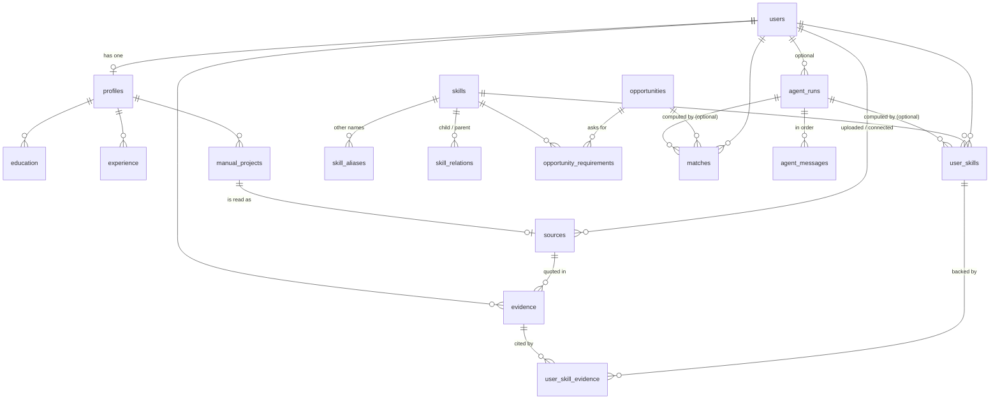

# Database schema v1

**Contract** (M2.4, D-019). **Owner: Rasen.** Change it only through a new migration, and for anything that changes meaning, with the owner's approval.
Code: `backend/app/db/models/` (one file per area), allowed values in `backend/app/db/values.py`, migration `backend/migrations/versions/2026_11_23-a3c8991e349d_schema_v1.py`.
Evidence definitions behind these tables: `docs/design/evidence-model.md`.

## The diagram

Arrows point from a row to the row it belongs to. **Bold** tables hold a user's personal data and are deleted with the user.

## The tables in plain words

| Area | Table | One row is… | Notes |
|---|---|---|---|
| People | **users** | a login | `email` stored lowercase and unique; `preferred_language` en/fr/ar, default en |
| | **profiles** | the user's profile (one per user) | `github_username`, `github_consent_at` (empty = no consent, import refuses, M3.9) |
| | **education**, **experience** | one entry the user typed (M3.3) | `position` orders the list |
| | **manual_projects** | a project the user described | read as a `sources` row of kind `manual_project` |
| Evidence | **sources** | one thing we read: CV, repo, certificate, manual project | `language` = detected language; `details` (JSON) = e.g. repo owner, fork flag, language shares; `storage_path` = uploaded file to delete with the account, relative to `UPLOAD_DIR`; `text` = plain text read from an uploaded CV (M3.5) or a repo's README (M3.6) |
| | **evidence** | one exact quote that mentions or shows a skill | `type`, `quote` (≤ 300 chars, never translated), `location` (JSON), `language`. No source only for `user_added` |
| | **user_skills** | one skill on one person's profile | `status`, `confidence`, `hidden`, `disputed`, `produced_by` (rules / single_agent / multi_agent) |
| | **user_skill_evidence** | an evidence link | `judgement` (supports / weak), `reason_code`, `inferred_from` (skill ids) |
| Skill list | skills | one skill | `id` is the readable slug from skills.csv (`postgresql`); `name_en`, `name_fr`, `name_ar`; shared, not personal |
| | skill_aliases | another name for a skill | stored lowercase; one skill per alias |
| | skill_relations | "child belongs under parent" | postgresql → sql → databases |
| Postings | opportunities | one curated posting | `kind` internship / job; `language`; source `url` |
| | opportunity_requirements | one skill a posting asks for | `raw_text` (posting's words), `skill_id` once mapped, `importance` required / nice_to_have |
| | **matches** | latest match of one user with one posting | `score` 0–1, `category`, `details`, `gaps`, `recommendations` (JSON), `language` of the explanations |
| Run log | **agent_runs** | one workflow run by one system | user optional (evaluation runs have none); counters for LLM calls and tokens; `stop_reason` |
| | **agent_messages** | one message in a run | `sequence` orders them; full `envelope` as JSON until D-007 is decided |

## Rules the database enforces

- **Allowed values** for every fixed list (language, source kind, evidence type, judgement, status, confidence, system, run status, posting kind, importance). They're text columns with a CHECK. The lists live in `app/db/values.py`.
- **Deleting a user deletes everything personal** (ON DELETE CASCADE from `users` down every bold table). Skills, postings and requirements stay. Test: `tests/db/test_delete_user.py`.
- **A skill can only cite its own user's evidence.** `user_skill_evidence.user_id` is part of both foreign keys, to `user_skills (id, user_id)` and to `evidence (id, user_id)`.
- `unverified` is always `low` confidence. One `user_skills` row per (user, skill). One `matches` row per (user, posting).
- An evidence quote is at most 300 characters. Evidence has a source unless it is `user_added`.
- A `sources` row has `manual_project_id` exactly when its kind is `manual_project`. Deleting the project deletes its source and evidence.
- Skill ids are lowercase slugs; aliases are lowercase; a skill can't be its own parent; `score` is between 0 and 1.
- Deleting a skill that a profile or posting uses is refused (RESTRICT). Deleting a run keeps the skills and matches it computed (their `agent_run_id` becomes empty).

## Rules left to the code (services and the M4.4 / M6.3 validator)

- Every `user_skills` row has at least one link ("no skill without a source").
- Status and confidence are exactly what the evidence-model rules compute from the links.
- `supports` is never used on `cv_education`, `repo_dependency` or `repo_readme`, nor on a `repo_language` link that fails the 10 % / owned / not-a-fork test.
- `assessed` is never written in the MVP (D-014).
- A manual project's source belongs to the same user as the project.

These need data from several rows, which plain CHECK constraints can't see. Triggers could do it, but they'd hide logic where few people look.

## Where the "decide later" items live

| Need | Where | Slice |
|---|---|---|
| Education, experience, manual projects | own tables | M3.3 |
| GitHub consent | `profiles.github_consent_at` | M3.9 |
| Gaps and recommendations | JSON on `matches` | M8.1–M8.3 |
| User's preferred language | `users.preferred_language` | M3.3 |
| Source / quote / posting language | `sources.language`, `evidence.language`, `opportunities.language` | M3.5, M4.x |
| Skill names in three languages | `skills.name_en`, `name_fr`, `name_ar` | M4.1, M4.9 |
| Message envelope columns | `agent_messages.envelope` (JSON) for now | M2.5 / D-007 |
| Match categories | `matches.category`, no fixed list yet | M7 |

## Changing the schema

1. Change the model in `backend/app/db/models/`.
2. `cd backend && uv run alembic revision --autogenerate -m "<what changed>"`, then read the generated file.
3. **Autogenerate doesn't notice changed CHECK lists.** If you changed `app/db/values.py`, add `op.drop_constraint(...)` and `op.create_check_constraint(...)` by hand.
4. `uv run pytest`: `test_models_match_the_migrations` fails if the models and migrations disagree.
5. Never edit a merged migration; add a new one.
